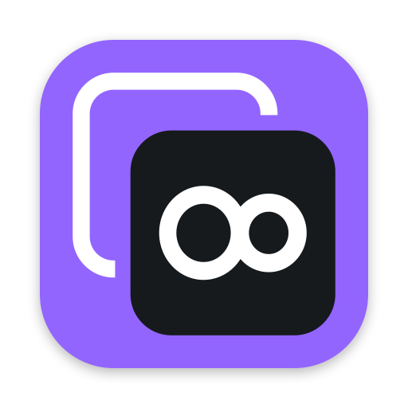
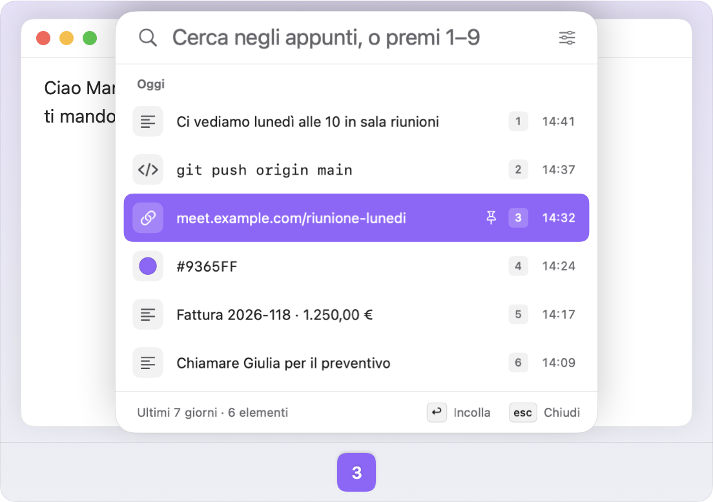
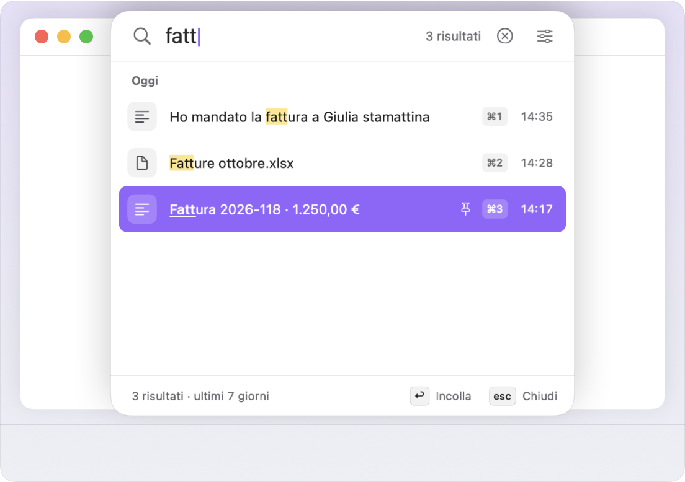

<div align="center">

<a href="https://8wavesrl.github.io/Copy8/"></a>

# Copy8

**La cronologia degli appunti per macOS.**<br>
Premi ⌥V in qualsiasi app, cerca quello che hai copiato e incollalo dove stavi scrivendo.

`macos` `appunti` `clipboard-manager` `menu-bar` `swift` `swiftui`

[](https://github.com/8wavesrl/Copy8/releases/latest)


[**Scarica Copy8**](https://github.com/8wavesrl/Copy8/releases/latest) · [Sito](https://8wavesrl.github.io/Copy8/) · [Novità di ogni versione](https://github.com/8wavesrl/Copy8/releases)

<br>

<picture>
  <source media="(prefers-color-scheme: dark)" srcset=".github/assets/finestra-scuro.png">
  
</picture>

<br>
<br>

sviluppata con ❤️ da

<br>

[](https://8wave.it)

<br>

</div>

## Cosa fa

- **Sempre a portata di mano**: ⌥V apre la cronologia sopra qualsiasi app, al frame successivo alla scorciatoia.
- **Ricerca full text**: ignora maiuscole e accenti e cerca anche nel nome dell'app da cui hai copiato.
- **Incolla dove stavi scrivendo**: con ↩ o con il numero della riga, da 1 a 9.
- **Più elementi insieme**: con ⌘ clic metti in coda più righe e le incolli in un colpo solo, nell'ordine scelto.
- **Elementi fissati**: quello che ti serve sempre resta in cima e non scade mai.
- **Riconosce ogni tipo di copia**: testo, testo formattato, link, codice, colori, immagini e file.
- **Rispetta le password**: salta quello che i password manager marcano come riservato.
- **Come piace a te**: tema chiaro o scuro, il colore che preferisci, effetto vetro regolabile.
- **Tutto resta sul Mac**: nessun account e nessuna connessione a internet.

## Installare

Scarica dalla [pagina dell'ultima versione](https://github.com/8wavesrl/Copy8/releases/latest) il DMG per il
tuo Mac, aprilo e trascina Copy8 in Applicazioni. Serve macOS 14 o successivo.

| Mac | DMG |
|---|---|
| Con chip Apple, M1 e successivi | `Copy8-<versione>-apple-silicon.dmg` |
| Con processore Intel | `Copy8-<versione>-intel.dmg` |

Per sapere quale hai, apri menu Apple › Informazioni su questo Mac: i Mac con chip Apple hanno la voce "Chip"
con "Apple M…", quelli Intel la voce "Processore" con "Intel".

Copy8 è firmata con il certificato Developer ID di 8 wave srl e autenticata da Apple, quindi si apre senza
avvisi. Per aggiornarla, trascina la nuova versione in Applicazioni sostituendo quella che hai.

### Il permesso Accessibilità

Per incollare direttamente nell'app attiva Copy8 simula ⌘V, e macOS lo consente solo con il permesso in
Impostazioni di Sistema › Privacy e sicurezza › Accessibilità. Senza permesso l'elemento viene copiato negli
appunti e basta premere ⌘V.

Se dopo un aggiornamento l'incolla diretto smette di funzionare, togli Copy8 dall'elenco Accessibilità con il
tasto − e aggiungilo di nuovo.

## Come si usa

Copy8 vive nella barra dei menu e non compare nel Dock. La sua icona è una cartellina con il simbolo di 8 wave,
che si riempie per un attimo quando Copy8 registra una copia. Il menu dell'icona mostra le ultime 5 copie, che
si incollano con un clic, e porta alle impostazioni.

Premi ⌥V in qualsiasi app: si apre la finestra con tutto quello che hai copiato negli ultimi giorni, dal più
recente al più vecchio. Scegli una riga e Copy8 la incolla dove stavi scrivendo.

| Tasti | Azione |
|---|---|
| ↑ ↓, Pagina su/giù | Scegli l'elemento |
| ↩ | Incolla nell'app attiva |
| ⌥↩ | Incolla come testo semplice |
| ⇧ clic | Incolla la riga e lascia la finestra aperta, per incollare altre righe una dopo l'altra (serve il permesso Accessibilità: senza, la finestra si chiude come con il clic) |
| 1 … 9 | A ricerca vuota, incolla l'elemento in quella posizione (il numero è sulla riga); il 9 apre il tutorial finché la sua riga c'è |
| ⌘ clic, ⌘1 … ⌘9, ⌘↩ | Mette la riga in coda, per incollare più elementi insieme (vedi sotto) |
| ⌘C | Copia senza incollare (se nel campo di ricerca non c'è testo selezionato) |
| ⌘P | Fissa l'elemento con la puntina, o lo toglie dai fissati |
| ⌘⌫ | Elimina l'elemento |
| ⌘, | Impostazioni |
| esc | Svuota la coda, poi la ricerca, poi chiude |

### Cercare

<picture>
  <source media="(prefers-color-scheme: dark)" srcset=".github/assets/ricerca-scuro.png">
  
</picture>

Scrivi e basta: la ricerca ignora maiuscole e accenti e richiede tutte le parole scritte, in qualunque punto
del testo o nel nome dell'app di origine, ed evidenzia dove le trova. A ricerca vuota i tasti 1–9 scelgono una
riga: per cercare un testo che inizia con un numero, scrivi prima uno spazio. Clic destro su una riga per
incollare, copiare, fissare o eliminare.

### Incollare più elementi insieme

Tieni premuto ⌘ e scegli le righe una dopo l'altra, con un clic o con il loro numero: entrano in coda
nell'ordine in cui le scegli, e al posto dell'icona compare il numero d'ordine. Poi scegli l'ultima senza ⌘,
con un clic o con il numero: Copy8 incolla tutto in quell'ordine. Per esempio ⌘ clic sulle righe 1, 6 e 3,
poi clic sulla 8, incolla 1, 6, 3, 8.

- ↩ incolla la coda così com'è; esc la svuota; ⌘ clic su una riga già in coda la toglie.
- La coda resta mentre cerchi, quindi puoi cercare, aggiungere e cercare ancora.
- Se gli elementi sono tutti testo vengono incollati come un testo solo, una riga per elemento e senza
  formattazione. Se ci sono immagini o file ogni elemento resta separato negli appunti, e dipende dall'app
  di destinazione se li incolla tutti o solo il primo.

### Elementi fissati

Un elemento fissato con la puntina (⌘P, il clic sulla puntina della riga selezionata o il menu con il tasto
destro) sta nella sezione "Fissati" in cima all'elenco e non viene mai cancellato in automatico: né dopo i
giorni impostati né con "Cancella cronologia". Si elimina solo a mano. Nell'anteprima la riga
"Conservazione" dice fino a quando resta un elemento non fissato.

### Tutorial

Finché la cronologia ha meno di nove elementi, al posto della nona riga c'è una riga verde chiaro,
"Scopri come si usa Copy8": si apre con un clic o con il tasto 9. Alla nona copia la riga sparisce per sempre
e il tutorial resta in Impostazioni › Guida. Sono quattro animazioni (incollare, cercare, più elementi
insieme, puntina) fatte con gli stessi componenti della finestra, quindi seguono tema e colore dell'app.
Con "Riduci movimento" attivo nelle impostazioni di sistema mostrano un'immagine ferma. ← e → cambiano
pagina, esc chiude.

## Impostazioni

Si aprono dal menu dell'icona nella barra dei menu, oppure con ⌘, a finestra aperta.

- **Conserva gli elementi per**: numero di giorni (1–365, di serie 7). Quello che è più vecchio viene
  eliminato, tranne gli elementi fissati.
- **Incolla direttamente nell'app attiva**: se spento, Copy8 copia soltanto.
- **Apri la cronologia**: clicca e premi la nuova combinazione (serve ⌘, ⌃ o ⌥).
- **Avvia al login**.
- **Tema**: Sistema, Chiaro, Scuro.
- **Colore**: qualsiasi colore, scelto con la tavolozza dei colori di macOS; di serie il viola di 8 wave
  (#9365FF). Colora la riga selezionata, la coda, i link, gli interruttori delle impostazioni e il tutorial. Il
  testo sopra diventa bianco o nero e i link si scuriscono o si schiariscono, perché si leggano con ogni colore.
- **Nella barra dei menu**: Icona (di serie), Icona e ultima copia (i primi 10 caratteri accanto all'icona,
  visibili anche quando condividi lo schermo), Nascosta. Senza icona le impostazioni si aprono dalla finestra
  con ⌘, oppure riaprendo Copy8 da Applicazioni.
- **Mostra anteprima**: pannello di destra con il contenuto completo e i dettagli.
- **Effetto vetro** e **Intensità** (1–100), con anteprima dal vivo. A 1 la superficie è quasi piena, a 100
  la finestra è vetro lucido e molto trasparente. La sfocatura resta piena fino a circa 40 e a 100 ne resta
  circa un terzo; la tinta della superficie scende dal 94% a circa il 24%; da metà scala in su compaiono i
  riflessi (filo di luce sul bordo, riflesso in alto, bordo inferiore più scuro) e un alone dietro il testo
  che lo tiene leggibile su qualsiasi sfondo.
- **Ignora password e contenuti riservati**: salta quello che i password manager marcano come riservato.
- **Cancella cronologia…**: si può annullare finché la finestra delle impostazioni è aperta. Gli elementi
  fissati restano.
- **Come si usa Copy8**: apre il tutorial.

## Privacy e dati

Copy8 non si collega a internet e non ha account: tutto resta sul Mac, in
`~/Library/Application Support/Copy8/`. `history.sqlite` contiene testi, link e percorsi, la cartella
`Images/` le immagini. Copy8 riconosce testo, link, codice, colori (`#RRGGBB`, `rgb()`), immagini e file. Il
testo formattato (RTF, HTML) viene conservato e incollato così com'era. Copy8 ignora un testo più lungo di un
milione di caratteri e un'immagine più grande di 40 MB.

## Sviluppo

### Compilare

Servono gli strumenti da riga di comando di Xcode (`xcode-select --install`). Lo stesso codice viene compilato
una volta per i Mac con chip Apple (arm64) e una per i Mac Intel (x86_64): le due app finiscono in
[`platform/`](platform/README.md).

```bash
scripts/build-app.sh                    # crea platform/apple-silicon/Copy8.app e platform/intel/Copy8.app
scripts/build-app.sh --dmg              # crea anche un DMG per piattaforma
scripts/build-app.sh --notarize         # crea i DMG e li fa autenticare da Apple, per distribuirli
scripts/build-app.sh --install          # copia in /Applications la versione per questo Mac
scripts/build-app.sh --platform intel   # una sola piattaforma, apple-silicon o intel: fa prima
```

Su un Mac con chip Apple la versione Intel si prova con Rosetta, installandola con `--platform intel --install`;
`--install` da solo rimette quella per il chip Apple. L'icona dell'app viene ridisegnata da
`scripts/make-icon.swift` quando cambia.

### Firma e permesso Accessibilità

macOS lega i permessi alla firma dell'app. Con il certificato Developer ID i permessi restano validi a ogni
ricompilazione. Se compili da solo senza quel certificato, crea una volta un certificato autofirmato con
`scripts/make-signing-cert.sh`: `build-app.sh` lo usa in automatico, con lo stesso effetto ma solo sul tuo
Mac. Senza certificato la firma è ad-hoc e cambia ogni volta.

Quando la firma cambia, anche passando dalla versione del DMG a una tua build o viceversa, macOS non
riconosce più il permesso e l'incolla smette di funzionare: togli Copy8 dall'elenco Accessibilità con il
tasto − e aggiungilo di nuovo.

### Pubblicare una versione

Per distribuire Copy8 servono il certificato "Developer ID Application" di 8 wave srl nel portachiavi, con la
sua chiave privata, e l'autenticazione (notarization) di Apple: senza, macOS blocca l'app scaricata anche se
è firmata. `build-app.sh` usa il certificato in automatico quando lo trova, con hardened runtime e timestamp.

Una volta sola, salva nel portachiavi le credenziali per l'autenticazione. Serve un Apple ID del team
8 wave srl e una password per app, da creare su [account.apple.com](https://account.apple.com) › Accesso e
sicurezza › Password per le app:

```bash
xcrun notarytool store-credentials "Copy8" --apple-id <Apple ID> --team-id GCQB48ZS4W
```

Poi, per ogni versione:

1. Aggiorna `CFBundleShortVersionString` e `CFBundleVersion` in `Support/Info.plist`.
2. Aggiorna in `docs/index.html` i due link ai DMG e il numero di versione, sotto il commento "Ogni versione".
3. Lancia `scripts/build-app.sh --notarize`. Lo script firma le due app e i loro DMG, invia i DMG ad Apple uno
   alla volta, aspetta l'esito (di solito pochi minuti ciascuno), aggancia il ticket a ogni DMG e controlla che
   Gatekeeper lo accetti. Se Apple rifiuta, stampa il log con il motivo.
4. Pubblica una release `v<versione>` con i due DMG, `platform/apple-silicon/Copy8-<versione>-apple-silicon.dmg`
   e `platform/intel/Copy8-<versione>-intel.dmg`.

### Sito

Il sito, [8wavesrl.github.io/Copy8](https://8wavesrl.github.io/Copy8/), è la cartella `docs/`, pubblicata da
GitHub Pages a ogni push su `main`: `index.html`, con stile, immagini e finestra di prova in `docs/assets/`.
Non usa librerie né caratteri esterni e i percorsi sono relativi. Per vederlo in locale:

```bash
python3 -m http.server -d docs 8000   # poi apri http://localhost:8000
```

Il viola è quello di [8wave.it](https://www.8wave.it/), lo stesso del colore di serie dell'app
(`Accent.eightWave` in `Theme.swift`): #9365FF, con #7E56DA al passaggio del mouse. Gli altri colori e le
misure della finestra di prova vengono da `Theme.swift` e `PanelView.swift`: se cambiano lì, vanno riportati in
`docs/assets/site.css`. Se cambia l'icona, dopo una compilazione copia `build/AppIcon.iconset/icon_256x256@2x.png`
in `docs/assets/copy8-icon.png` e `icon_32x32@2x.png` in `docs/assets/favicon.png`. Le schermate di questo
README sono in `.github/assets/`.

### Struttura

| File | Ruolo |
|---|---|
| `AppDelegate.swift` | Avvio, menu, collegamenti tra le parti |
| `ClipboardWatcher.swift` | Controlla gli appunti ogni 0,4 s e riconosce il tipo di contenuto |
| `Store.swift`, `History.swift` | Archivio SQLite e cronologia in memoria |
| `PanelController.swift`, `PanelModel.swift`, `PanelView.swift` | La finestra: tastiera, ricerca, elenco, anteprima |
| `Paster.swift` | Scrive negli appunti e simula ⌘V |
| `HotKey.swift` | Scorciatoia globale (Carbon, non richiede permessi) |
| `StatusBar.swift` | Icona e menu nella barra dei menu |
| `EightWaveMark.swift` | Il simbolo di 8 wave, per l'icona della barra dei menu e per quella dell'app (`scripts/make-icon.swift`) |
| `Credits.swift` | "Sviluppata da 8 wave": logo nelle impostazioni, scritta nella finestra e nel menu |
| `SettingsView.swift`, `Settings.swift` | Impostazioni e loro salvataggio |
| `Theme.swift` | Token del design system, chiaro e scuro, e colore scelto |
| `Toast.swift` | Conferma dopo l'incolla |
| `Tutorial.swift` | Finestra del tutorial e le sue animazioni |

La finestra viene creata e disegnata una volta all'avvio e poi solo mostrata, così si apre al frame
successivo alla scorciatoia.

## Licenza

[MIT](LICENSE)
